# Gemini prompts: the painted sky above 11 far strips (X-16, polish-edges, 2026-10-29)

Why: upright, the far strip now sits at the size sideways uses, and a painted sky goes above it (`<stem>-sky.webp`). 23 sets have
one. These 11 don't: four HF rounds painted good skies but never a clean join where the strip cuts off its trees, so they still use
the cover fit (the far strip enlarged to fill the screen). Failed takes: `../qa-notes/polish-edges/skies-r5/failures.jpg`.

Note: QUEUE.md records Matt (2026-10-29, 1:10 PM ET) moving every sheet to Hugging Face. These were written for Gemini at the lead's
ask. If Gemini is off, they are the content spec for an HF helper.

How to use: one at a time (Matt's way). Attach the reference picture (`refs/x16-NN-<stem>-ref.jpg`, the whole far strip), paste the
prompt, and send back what Gemini paints. The join is done by hand: the new picture is laid above the strip and blended over its top
rows, so it doesn't need to be perfect at the very bottom edge, only the right shapes in the right places. The still beside each
prompt is the strip's top edge: the part the new picture has to carry on from.

Every prompt starts with the same opening, then a few lines for that set. Each block below is complete: paste it as it is.

---

## 1. w1kapok (stages 1-7, 1-8, 1-9: the great kapok)

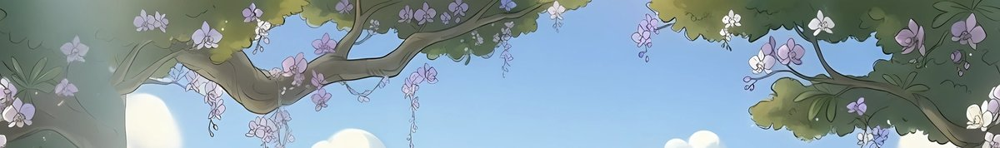 Reference: `refs/x16-01-w1kapok-ref.jpg`

> In exactly the style of the attached picture (a cute hand-painted 2D side-scrolling jungle game background: soft cel shading, gentle
> dark outlines, hand-painted gouache brushwork), paint the part of the scene that sits directly ABOVE the attached picture, as if the
> camera tilted up. One wide picture, the same width as the attached one and about half its height. Its bottom edge carries straight on
> from the attached picture's top edge: everything the top edge cuts off (trunks, branches, leaves, rock, clouds) continues upward from
> the same place, at the same size, in the same colours and light. Its left and right edges match each other so it repeats side to
> side. No ground, no horizon, no second landscape, no frame or border, no text, no characters or animals.
> Here: the kapok tree's big leafy branches with lilac orchids carry on up at the left and right and thin out into a few sprays of
> leaves against a bright clear blue morning sky with soft white clouds in the middle. The tops of the leaf clusters end in a natural
> ragged outline, never a straight line.

## 2. w1sunrise (stages 1-1, 1-2, 1-3)

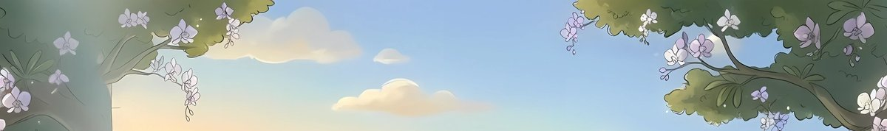 Reference: `refs/x16-02-w1sunrise-ref.jpg`

> In exactly the style of the attached picture (a cute hand-painted 2D side-scrolling jungle game background: soft cel shading, gentle
> dark outlines, hand-painted gouache brushwork), paint the part of the scene that sits directly ABOVE the attached picture, as if the
> camera tilted up. One wide picture, the same width as the attached one and about half its height. Its bottom edge carries straight on
> from the attached picture's top edge: everything the top edge cuts off (trunks, branches, leaves, rock, clouds) continues upward from
> the same place, at the same size, in the same colours and light. Its left and right edges match each other so it repeats side to
> side. No ground, no horizon, no second landscape, no frame or border, no text, no characters or animals.
> Here: the orchid branches in the top corners carry on up a little and end in leafy sprays; the middle is open sunrise sky, pale blue
> above fading to warm gold near the bottom, with a few soft cream and pink clouds. Calm and light, no sun disc.

## 3. w3sinkhole (stages 3-4, 3-5)

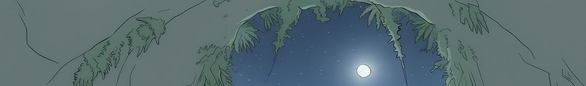 Reference: `refs/x16-03-w3sinkhole-ref.jpg`

> In exactly the style of the attached picture (a cute hand-painted 2D side-scrolling jungle game background: soft cel shading, gentle
> dark outlines, hand-painted gouache brushwork), paint the part of the scene that sits directly ABOVE the attached picture, as if the
> camera tilted up. One wide picture, the same width as the attached one and about half its height. Its bottom edge carries straight on
> from the attached picture's top edge: everything the top edge cuts off (trunks, branches, leaves, rock, clouds) continues upward from
> the same place, at the same size, in the same colours and light. Its left and right edges match each other so it repeats side to
> side. No ground, no horizon, no second landscape, no frame or border, no text, no characters or animals.
> Here: we are inside a deep sinkhole. Above the attached picture is more of the same grey-green mossy rock wall, with ferns, hanging
> roots and thin vines, a little darker and mistier as it rises. No second opening and no sky: the round opening with the moon is only
> in the attached picture.

## 4. w5dusk2 (World 5 dusk mood)

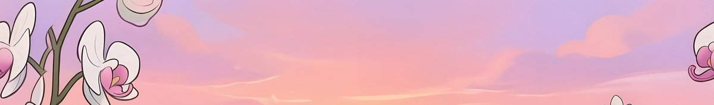 Reference: `refs/x16-04-w5dusk2-ref.jpg`

> In exactly the style of the attached picture (a cute hand-painted 2D side-scrolling jungle game background: soft cel shading, gentle
> dark outlines, hand-painted gouache brushwork), paint the part of the scene that sits directly ABOVE the attached picture, as if the
> camera tilted up. One wide picture, the same width as the attached one and about half its height. Its bottom edge carries straight on
> from the attached picture's top edge: everything the top edge cuts off (trunks, branches, leaves, rock, clouds) continues upward from
> the same place, at the same size, in the same colours and light. Its left and right edges match each other so it repeats side to
> side. No ground, no horizon, no second landscape, no frame or border, no text, no characters or animals.
> Here: the big white and pink orchid stems at the left and right carry on up, with one or two more blooms, then end; the rest is a
> pink and lilac dusk sky with soft painted clouds, a little deeper lilac towards the top.

## 5. w5twi1 (World 5 twilight mood)

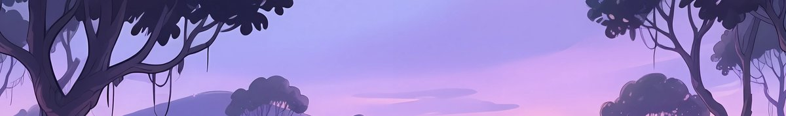 Reference: `refs/x16-05-w5twi1-ref.jpg`

> In exactly the style of the attached picture (a cute hand-painted 2D side-scrolling jungle game background: soft cel shading, gentle
> dark outlines, hand-painted gouache brushwork), paint the part of the scene that sits directly ABOVE the attached picture, as if the
> camera tilted up. One wide picture, the same width as the attached one and about half its height. Its bottom edge carries straight on
> from the attached picture's top edge: everything the top edge cuts off (trunks, branches, leaves, rock, clouds) continues upward from
> the same place, at the same size, in the same colours and light. Its left and right edges match each other so it repeats side to
> side. No ground, no horizon, no second landscape, no frame or border, no text, no characters or animals.
> Here: the dark purple tree canopies at the left and right carry on up and close in a natural rounded leafy outline; between them a
> lilac and violet twilight sky with soft pink clouds and two or three first stars, deeper violet towards the top. Calm and light, not
> smoky.

## 6. w5twi2 (World 5 twilight mood)

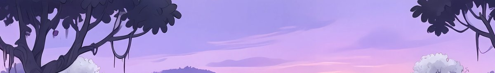 Reference: `refs/x16-06-w5twi2-ref.jpg`

> In exactly the style of the attached picture (a cute hand-painted 2D side-scrolling jungle game background: soft cel shading, gentle
> dark outlines, hand-painted gouache brushwork), paint the part of the scene that sits directly ABOVE the attached picture, as if the
> camera tilted up. One wide picture, the same width as the attached one and about half its height. Its bottom edge carries straight on
> from the attached picture's top edge: everything the top edge cuts off (trunks, branches, leaves, rock, clouds) continues upward from
> the same place, at the same size, in the same colours and light. Its left and right edges match each other so it repeats side to
> side. No ground, no horizon, no second landscape, no frame or border, no text, no characters or animals.
> Here: the dark purple tree canopies at the left and right carry on up and close in a natural rounded leafy outline; between them a
> lilac and violet twilight sky with soft pink clouds and two or three first stars, deeper violet towards the top. Calm and light, not
> smoky.

## 7. w7 (World 7 ruins)

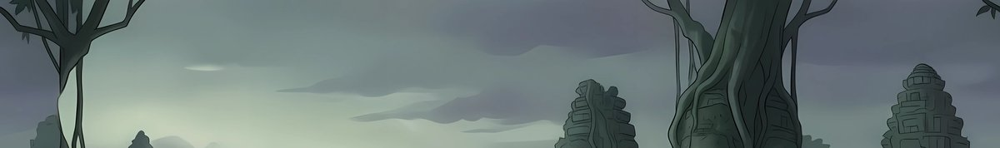 Reference: `refs/x16-07-w7-ref.jpg`

> In exactly the style of the attached picture (a cute hand-painted 2D side-scrolling jungle game background: soft cel shading, gentle
> dark outlines, hand-painted gouache brushwork), paint the part of the scene that sits directly ABOVE the attached picture, as if the
> camera tilted up. One wide picture, the same width as the attached one and about half its height. Its bottom edge carries straight on
> from the attached picture's top edge: everything the top edge cuts off (trunks, branches, leaves, rock, clouds) continues upward from
> the same place, at the same size, in the same colours and light. Its left and right edges match each other so it repeats side to
> side. No ground, no horizon, no second landscape, no frame or border, no text, no characters or animals.
> Here: the great root-wrapped tree trunks and hanging lianas carry on up and open into dark green leafy canopy at the very top corners;
> the middle is a grey-green overcast sky with soft layered clouds, a little brighter near the bottom.

## 8. w7dawn (World 7 dawn mood)

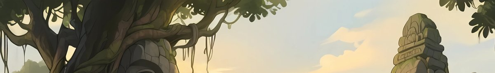 Reference: `refs/x16-08-w7dawn-ref.jpg`

> In exactly the style of the attached picture (a cute hand-painted 2D side-scrolling jungle game background: soft cel shading, gentle
> dark outlines, hand-painted gouache brushwork), paint the part of the scene that sits directly ABOVE the attached picture, as if the
> camera tilted up. One wide picture, the same width as the attached one and about half its height. Its bottom edge carries straight on
> from the attached picture's top edge: everything the top edge cuts off (trunks, branches, leaves, rock, clouds) continues upward from
> the same place, at the same size, in the same colours and light. Its left and right edges match each other so it repeats side to
> side. No ground, no horizon, no second landscape, no frame or border, no text, no characters or animals.
> Here: the great carved tree on the left carries on up into its full leafy canopy, which ends in a natural rounded outline; the leaves
> on the right edge carry on a little; the rest is a warm pale dawn sky, soft blue at the top fading to cream and gold, with a few soft
> clouds. No smoke, no dark clouds.

## 9. w7dusk (World 7 dusk mood)

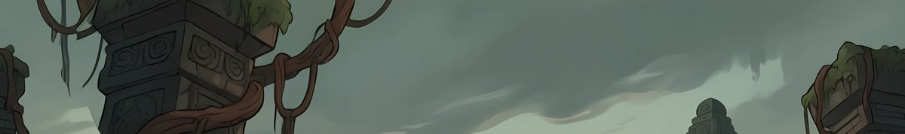 Reference: `refs/x16-09-w7dusk-ref.jpg`

> In exactly the style of the attached picture (a cute hand-painted 2D side-scrolling jungle game background: soft cel shading, gentle
> dark outlines, hand-painted gouache brushwork), paint the part of the scene that sits directly ABOVE the attached picture, as if the
> camera tilted up. One wide picture, the same width as the attached one and about half its height. Its bottom edge carries straight on
> from the attached picture's top edge: everything the top edge cuts off (trunks, branches, leaves, rock, clouds) continues upward from
> the same place, at the same size, in the same colours and light. Its left and right edges match each other so it repeats side to
> side. No ground, no horizon, no second landscape, no frame or border, no text, no characters or animals.
> Here: the carved stone pillars wrapped in red-brown vines carry on up and end in broken mossy tops with leaves; the vines curl over
> them. The rest is a dim green-gold dusk sky with soft dark teal clouds. No black smoke.

## 10. w10after (World 10 after the storm)

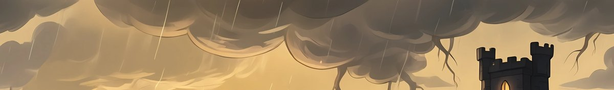 Reference: `refs/x16-10-w10after-ref.jpg`

> In exactly the style of the attached picture (a cute hand-painted 2D side-scrolling jungle game background: soft cel shading, gentle
> dark outlines, hand-painted gouache brushwork), paint the part of the scene that sits directly ABOVE the attached picture, as if the
> camera tilted up. One wide picture, the same width as the attached one and about half its height. Its bottom edge carries straight on
> from the attached picture's top edge: everything the top edge cuts off (trunks, branches, leaves, rock, clouds) continues upward from
> the same place, at the same size, in the same colours and light. Its left and right edges match each other so it repeats side to
> side. No ground, no horizon, no second landscape, no frame or border, no text, no characters or animals.
> Here: the heavy dark storm clouds at the top of the attached picture carry on up as a thick, churning storm ceiling, with gaps
> breaking up and golden light showing through, a few rain streaks and one faint branch of lightning. The castle tower is not repeated.

## 11. w6dawn (stages 6-1, 6-2, 6-3)

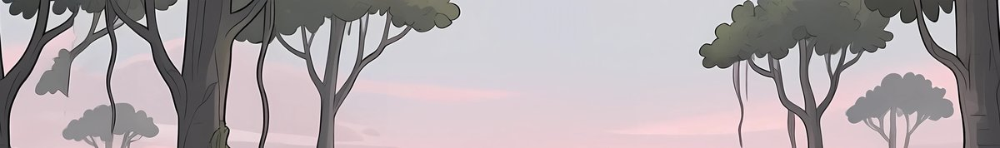 Reference: `refs/x16-11-w6dawn-ref.jpg`

> In exactly the style of the attached picture (a cute hand-painted 2D side-scrolling jungle game background: soft cel shading, gentle
> dark outlines, hand-painted gouache brushwork), paint the part of the scene that sits directly ABOVE the attached picture, as if the
> camera tilted up. One wide picture, the same width as the attached one and about half its height. Its bottom edge carries straight on
> from the attached picture's top edge: everything the top edge cuts off (trunks, branches, leaves, rock, clouds) continues upward from
> the same place, at the same size, in the same colours and light. Its left and right edges match each other so it repeats side to
> side. No ground, no horizon, no second landscape, no frame or border, no text, no characters or animals.
> Here: the tall dark mangrove trunks carry on up, with hanging moss, and open into soft dark green leafy canopy at the very top;
> between them a pale pink and lavender dawn sky with soft misty clouds. Light and calm, no smoke.

---

When a picture comes back: `tools/art/hfbatch/skycut.py` takes a canvas (the new sky, then the strip's top rows). Lay the picture
above the strip at the strip's width, blend by hand over the strip's top 5-10%, then cut it, and check upright with
`tools/art/edges/shots.mjs` as in `../qa-notes/polish-edges/skies-r4/`.
