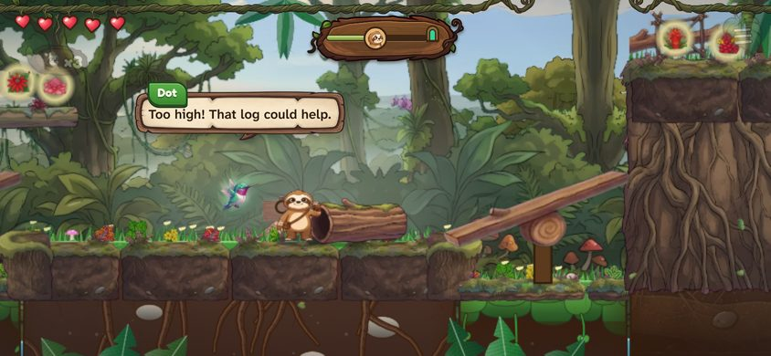
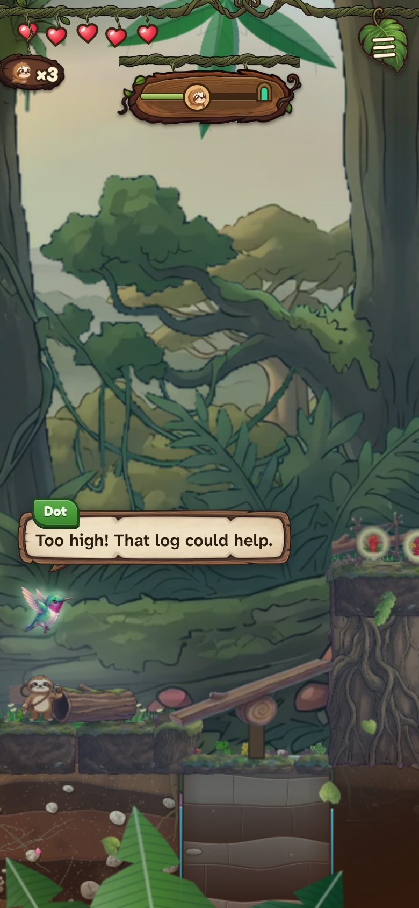
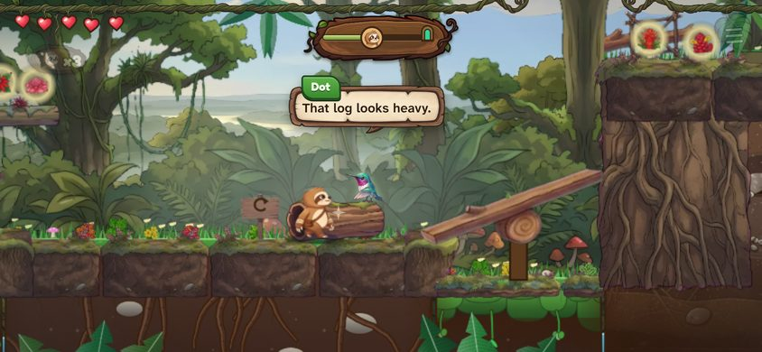
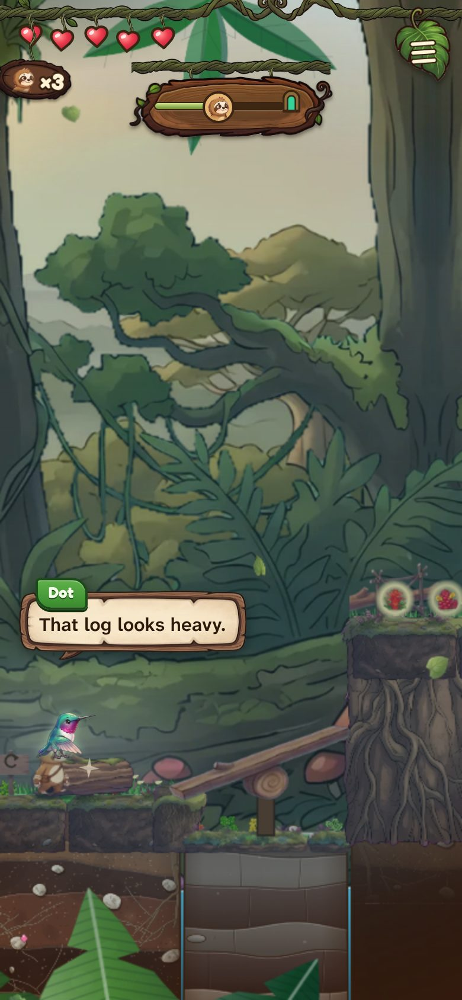
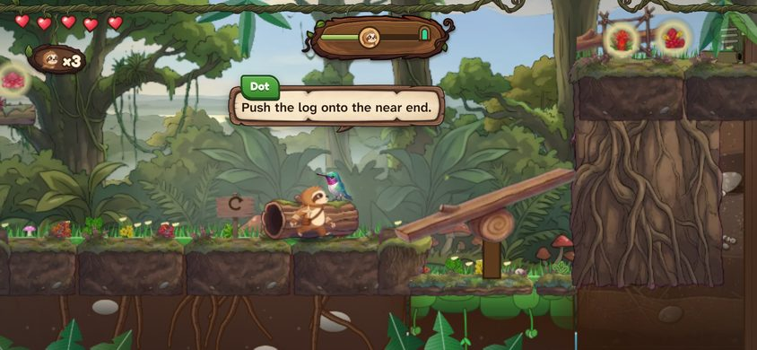
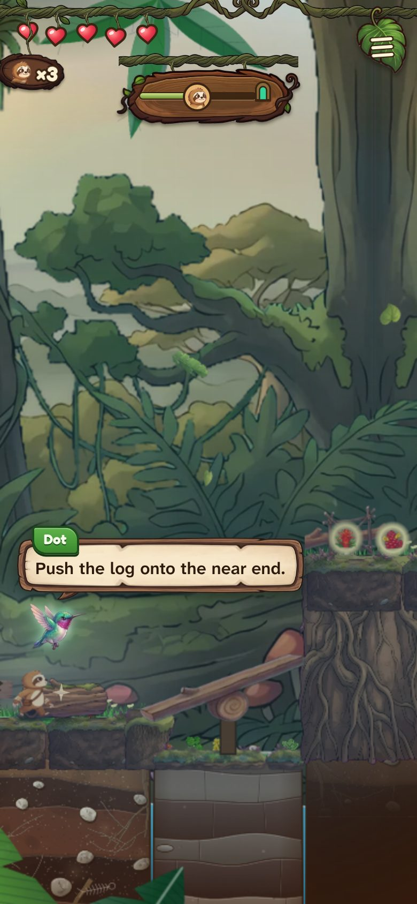
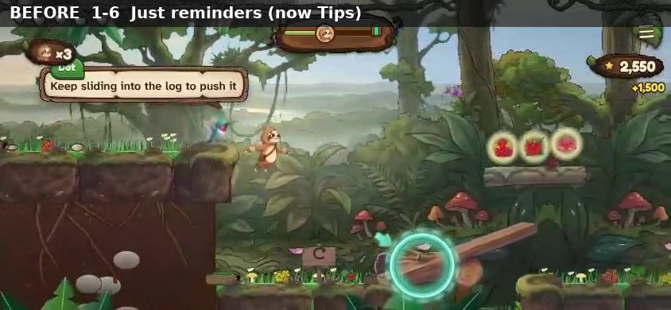
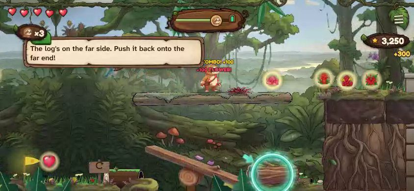

# Dot curbed: the preview (1-6 and 4-3)

> **Superseded by [../final/README.md](../final/README.md)** (the full rework, 2026-10-29). The clips linked below are the final
> ones, re-recorded on the finished code; the numbers on this page are the show-first preview's.

A show-first preview for Matt before the full rework (branch `polish-dot`). Nothing here is released.

Matt, 2026-10-29: *"When I'm playing through, it feels like she's constantly nagging me... we're drawing a weird blue box around
things that doesn't even show where it's at... As soon as they run in, Dot tells exactly how to do it."*

## What changes

- **Tips** (was "Just reminders", Matt's setting): Dot says only the first time of each new thing (once per save), the warning for a
  new hazard the first time, why an exit is locked, and help after real struggle (two deaths in one spot, or two failed tries in a
  puzzle). Gone on Tips: reminders, "Still N to collect!", "This way, Pokey!", nags on a clock, tips again on replays, story chatter in
  play (the story beats between stages and the wayside story lines stay). At least 30 s between lines that can wait.
- **Help** (was "Teach me", for new kids): says more: every first time, plus reminders. Now 15 s between lines that can wait (was
  10), the same words at most once a stage and a warning at most twice (the eagle's "Hide!" came every pass), a line cut after 1.5 s
  is not said again, calm in every world (World 5 had none), and never the answer on walking in. This takes Help down only about 10%
  so far: most of what it says is first-time teaching. See the questions at the end.
- **No spoilers in puzzles.** Walking in, she names the problem ("Too high! That log could help."). Only if he goes back and forth or
  fails twice does she point at the piece ("That log looks heavy."). Only on Help, and only after more struggle, does she say the
  move ("Push the log onto the near end."). On Tips a puzzle room is silent unless its idea is brand new (the first seesaw).
- **No blue ring, no arrow.** When she points, she flies to the thing and sits on it (on the log), with a small sparkle on the thing
  itself. Why the old ring was off: it circled the nearest thing of the line's kind, not the one meant (the log
  wedged on the seesaw ahead, not the log to push), a puzzle room circled the seesaw's pivot, a gap tip circled a spot in the air 34 px
  past the edge, and she sat up to 320 px away and drew an arrow across. Now the seesaw room points at the log until
  it is on the seesaw, then at the raised end; a gap tip points at the edge itself; and she sits within about 80 px of the thing.
- **Tips no longer thrown away (DOT-1).** A tip counts as heard only after it has been on screen 1.5 s. A line the setting dropped is
  kept for later. A New Game teaches everything again, and the menu gets a **"Hear Dot's tips again"** button under the setting.
- Smaller fixes in this round: a lesson no longer cuts a line in its first 1.5 s and makes it repeat (DOT-6); the reading time starts
  when the bubble appears, not before her flight (DOT-7); calm rules in World 5 (DOT-8); 1-9's locked snake ring is now explained
  (DOT-4); Skip tips is never on 1-1's coach lines (DOT-5); "stuck" is back and forth, never a clock, and never in a puzzle room
  (DOT-11); a second death in one spot gets help for what got him on Help, the log first (DOT-10).

## How it was measured

The review's tool (the brisk route walked in the real engine, tools/inspect/dotPace.ts), but playing every stage of Worlds 1-6 **in
order on one save**, so "once per save" counts as it does for a real player. "Before" is today's game with the same harness on the
same setting ("Just reminders" for Tips, "Teach me" for Help). It does not count the 1-1 coach lines or the wayside story beats (both
unchanged). Every stage's lines with their times are in `data/` (before and after, both settings); `data/pace-harness.mts` is the
harness, which runs on either build (`ROOT=<checkout> npx tsx pace-harness.mts --help teach|reminders --json out.json`); the new
`tools/inspect/dotPace.ts` measures the new build the same way. For reference, the review's own count (a fresh phone every stage, Teach me) was 9.5 lines a stage and 4.2 a minute in
Worlds 1-4, 5.2 a minute in World 5, busiest 30 s 9 lines.

### Lines a stage, a minute, and the busiest 30 s (Worlds 1-6, in order on one save)

| World | Setting | Lines a stage, before → after | Lines a minute, before → after | Busiest 30 s, before → after (worst stage after) |
|---|---|---|---|---|
| 1 | Tips (was Just reminders) | 4.1 → **2.8** | 1.97 → **1.33** | 4 → **4** (1-1) |
| 1 | Help (was Teach me) | 5.6 → **6.1** | 2.67 → **2.93** | 5 → **6** (1-7) |
| 2 | Tips (was Just reminders) | 1.9 → **1.2** | 0.98 → **0.63** | 2 → **2** (2-5) |
| 2 | Help (was Teach me) | 4.1 → **4.1** | 2.13 → **2.13** | 3 → **4** (2-3) |
| 3 | Tips (was Just reminders) | 3.9 → **1.7** | 1.68 → **0.72** | 4 → **2** (3-1) |
| 3 | Help (was Teach me) | 6.0 → **6.1** | 2.59 → **2.64** | 4 → **5** (3-2) |
| 4 | Tips (was Just reminders) | 3.0 → **2.2** | 1.12 → **0.83** | 6 → **3** (4-5) |
| 4 | Help (was Teach me) | 9.1 → **8.2** | 3.40 → **3.07** | 6 → **5** (4-5) |
| 5 | Tips (was Just reminders) | 6.4 → **1.9** | 3.20 → **0.95** | 6 → **4** (5-4) |
| 5 | Help (was Teach me) | 8.6 → **7.6** | 4.30 → **3.80** | 9 → **8** (5-9) |
| 6 | Tips (was Just reminders) | 2.3 → **0.2** | 1.12 → **0.11** | 5 → **1** (6-5) |
| 6 | Help (was Teach me) | 4.2 → **3.6** | 2.02 → **1.70** | 4 → **4** (6-7) |

Tips targets: about 1.5 a minute in Worlds 1-2 and 1 after, 2 in the busiest 30 s. Tips meets the per-minute targets in every world;
the busiest 30 s is still over 2 in 1-1, 4-5 and World 5 (see the end). Help is about the same as before in Worlds 1-3 and a little
quieter after; in 1-6 it gained lines because each puzzle room's first line now comes as he walks in (before, it often waited behind
another line and was lost when he left the room). Help needs Matt's call (question 2).

## 1-6 and 4-3, line by line (seconds into the brisk route)

#### 1-6 on Tips (was "Just reminders"): 6 lines → 3 (route 122 s; busiest 30 s 3 → 2)

**Before**

- 3 s · Flick up as you swing forward to leap.
- 23 s · That vine is too high. Climb the tree!
- 29 s · Flick up onto the mushroom to bounce.
- 47 s · Keep sliding into the log to push it
- 66 s · Fell? Climb the next tree back up
- 95 s · The log's on the far side. Push it back onto the far end!

**After**

- 3 s · Flick up as you swing forward to leap.
- 47 s · Keep sliding into the log to push it
- 54 s · See? The log holds that end down.

#### 1-6 on Help (was "Teach me"): 7 lines → 8 (route 122 s; busiest 30 s 3 → 4)

**Before**

- 3 s · Flick up as you swing forward to leap.
- 23 s · That vine is too high. Climb the tree!
- 29 s · Flick up onto the mushroom to bounce.
- 47 s · Keep sliding into the log to push it
- 60 s · Too high! Push the log onto the near end.
- 70 s · Fell? Climb the next tree back up
- 95 s · The log's on the far side. Push it back onto the far end!

**After**

- 3 s · Flick up as you swing forward to leap.
- 23 s · That vine is too high. Climb the tree!
- 29 s · Flick up onto the mushroom to bounce.
- 47 s · Keep sliding into the log to push it
- 54 s · See? The log holds that end down.
- 59 s · Too high! That log could help.
- 74 s · Fell? Climb the next tree back up
- 95 s · The log's moved. Hmm, that won't tip now.

#### 4-3 on Tips (was "Just reminders"): 5 lines → 3 (route 168 s; busiest 30 s 3 → 2)

**Before**

- 20 s · Another fall. Hop up beside it and stop it.
- 47 s · Flick up twice from the log's near end.
- 68 s · Slide down beside the fern to search it.
- 82 s · Flick up twice when it's at the top.
- 95 s · Ouch! Stop before the shadow. Go once it falls.

**After**

- 11 s · The water pushes you down. Climb up and stop it.
- 30 s · Monkey by that petal! If it grabs it, chase it.
- 63 s · Climb when it goes quiet. Wait in the cave.

#### 4-3 on Help (was "Teach me"): 12 lines → 11 (route 168 s; busiest 30 s 4 → 4)

**Before**

- 11 s · The water pushes you down. Climb up and stop it.
- 21 s · Another fall. Hop up beside it and stop it.
- 31 s · Monkey by that petal! If it grabs it, chase it.
- 45 s · This fall fills the pool. Ride the log first!
- 52 s · Flick up twice from the log's near end.
- 65 s · Climb when it goes quiet. Wait in the cave.
- 71 s · Slide down beside the fern to search it.
- 84 s · Flick up twice when it's at the top.
- 95 s · Ouch! Stop before the shadow. Go once it falls.
- 102 s · Flick up twice when it's at the top.
- 124 s · This one comes and goes. Climb when it's quiet.
- 155 s · Two falls, two beats. Climb one, then wait.

**After**

- 11 s · The water pushes you down. Climb up and stop it.
- 26 s · Another fall. Hop up beside it and stop it.
- 33 s · Monkey by that petal! If it grabs it, chase it.
- 45 s · That shelf's too high. Hmm.
- 60 s · Rocks again! Stop at the shadow. Go once it falls.
- 68 s · Climb when it goes quiet. Wait in the cave.
- 74 s · Slide down beside the fern to search it.
- 81 s · That ledge is out of reach. Hmm.
- 95 s · Ouch! Stop before the shadow. Go once it falls.
- 124 s · This one comes and goes. Climb when it's quiet.
- 155 s · Two falls, two beats. Climb one, then wait.

## The clips

Each pair is the same stretch of the stage, on the same save (everything before it played on that setting), walked the same way: the
inspector's brisk route, in the real game at phone size, sideways. The bar at the top says which build and which setting. A bot moves
Pokey along the route, so his animation is approximate and he never struggles (the pointing after struggle is in the screenshots
below). The clips also show the wayside story beats, which the tables do not count.

Each clip has today's game on top and the new one underneath, in step.

| Stage | Setting | Stretch | Clip (before on top, after below) |
|---|---|---|---|
| 1-6 | Tips | the start (0-40 s) | [1-6-tips-a-opening.mp4](../final/clips/1-6-tips-a-opening.mp4) |
| 1-6 | Tips | the log and the three seesaw rooms (44-100 s) | [1-6-tips-b-log-and-seesaws.mp4](../final/clips/1-6-tips-b-log-and-seesaws.mp4) |
| 1-6 | Help | the start (0-40 s) | [1-6-help-a-opening.mp4](../final/clips/1-6-help-a-opening.mp4) |
| 1-6 | Help | the log and the three seesaw rooms (44-100 s) | [1-6-help-b-log-and-seesaws.mp4](../final/clips/1-6-help-b-log-and-seesaws.mp4) |
| 4-3 | Tips | the first falls and the monkey (0-45 s) | [4-3-tips-a-first-falls.mp4](../final/clips/4-3-tips-a-first-falls.mp4) |
| 4-3 | Tips | the pool and the tide pool (40-100 s) | [4-3-tips-b-pools.mp4](../final/clips/4-3-tips-b-pools.mp4) |
| 4-3 | Help | the first falls and the monkey (0-45 s) | [4-3-help-a-first-falls.mp4](../final/clips/4-3-help-a-first-falls.mp4) |
| 4-3 | Help | the pool and the tide pool (40-100 s) | [4-3-help-b-pools.mp4](../final/clips/4-3-help-b-pools.mp4) |

## Pointing after struggle (Help), and why the old ring was off

Pokey walks back and forth in 1-6's second seesaw room (the room's "stuck" test: back and forth with nothing changing). First the
nudge, then (Help only) the move. Dot flies to the log and sits on it; the sparkle is on the log itself.

| | Sideways | Upright |
|---|---|---|
| Walking in (Help names the problem) |  |  |
| Nudge (Tips and Help) |  |  |
| The move (Help only) |  |  |

Today's ring, for comparison. Left: "Keep sliding into the log to push it", and the ring circles the log wedged on the seesaw ahead,
down in the thumb corner, not the log he is meant to push. Right: the twist room gives the answer as he walks in, the ring again in
the thumb corner.

| | |
|---|---|
|  |  |

## Puzzle lines, rewritten (these two stages; every other room comes in the full rework)

| Where | Walking in, before | Walking in, after (names the problem) | Nudge, after struggle (Tips and Help) | The move, after more struggle (Help only) |
|---|---|---|---|---|
| 1-6, first seesaw (new idea: Tips says this one) | The log holds that end down. Hop up the other end! | See? The log holds that end down. | That high end makes a step. | Hop up the other end! |
| 1-6, second seesaw | Too high! Push the log onto the near end. | Too high! That log could help. | That log looks heavy. | Push the log onto the near end. |
| 1-6, the twist | The log's on the far side. Push it back onto the far end! | The log's moved. Hmm, that won't tip now. | The log's past the seesaw now. | Push it back onto the far end! |
| 4-3, the pool | This fall fills the pool. Ride the log first! | That shelf's too high. Hmm. | That log floats. Could it lift you? | Flick up twice from the log's near end. |
| 4-3, the tide pool | Stand on the log. The pouring water lifts you. | That ledge is out of reach. Hmm. | The log rises while the water pours. | Flick up twice when it's at the top. |

In 4-3 the old "Flick up twice from the log's near end" and "Flick up twice when it's at the top" played as he walked up to the log;
now they only come on Help after struggle there.

## New and changed lines for Matt's approval

All under 10 words. Lines in the "move" column above that are the old words are already approved.

1. "See? The log holds that end down." (1-6, first seesaw, walking in)
2. "That high end makes a step." (1-6, first seesaw, nudge)
3. "Too high! That log could help." (1-6, second seesaw, walking in; the review's suggestion)
4. "That log looks heavy." (1-6, second seesaw, nudge)
5. "The log's moved. Hmm, that won't tip now." (1-6, twist, walking in; the review's suggestion)
6. "The log's past the seesaw now." (1-6, twist, nudge)
7. "That shelf's too high. Hmm." (4-3, the pool, walking in)
8. "That log floats. Could it lift you?" (4-3, the pool, nudge)
9. "That ledge is out of reach. Hmm." (4-3, the tide pool, walking in)
10. "The log rises while the water pours." (4-3, the tide pool, nudge)
11. Menu: the setting's names **Help / Tips / Quiet** (were Teach me / Just reminders / Quiet), with "Dot shows each new move, and
    helps more when you are stuck." and "Dot explains each new thing once, and helps if you struggle."
12. Menu button: **"Hear Dot's tips again"** (after a tap: "Dot will teach it all again").

## Questions for Matt (one at a time)

1. **Which setting should a new save start on?** (a) Tips on Normal, Help on Easy (recommended: Easy is the newcomer's pick at New
   Game); (b) Help for everyone, as today; (c) Tips for everyone.
2. **How much quieter should Help be?** (a) Help repeats a reminder only if the thing was taught in an earlier stage, never twice in
   one stage (recommended; not measured yet); (b) keep Help as in this preview; (c) Help is Tips plus the
   puzzle nudges and moves.
3. **The new lines above:** approve, or change any.

## What is not in this preview (the full rework, after Matt's OK)

- Every other puzzle room's lines (Worlds 2-5 rooms, 3-2's "No glowworms down here, and that bank is too high. That little mushroom
  glows, though.", the kit rooms), the Hush Fern secret (DOT-14) and the idol lesson (DOT-15).
- A few Tips stretches still hold 3 or more lines in 30 s: 1-1 (the first stage teaches the flag, the gap, the mushroom and the double
  jump within half a minute), 3-1 (spores, the dark, glowworms), 4-5 (the Sovereign, hiding, the lookout) and World 5 (5-1, 5-2, 5-4:
  its new things come close together). Each is a first time, so Tips says it; the fix is spacing them in the stage or merging lines.
- World 6 on Tips says almost nothing (0.2 lines a stage): its gen2 lines need their "first time" marks, and the water warning there
  must be checked.
- DOT-9, DOT-13, DOT-16 (Crocus Rex and the Queen coaching), DOT-17, and the Help pacing in World 5 (still about 4 lines a minute).
